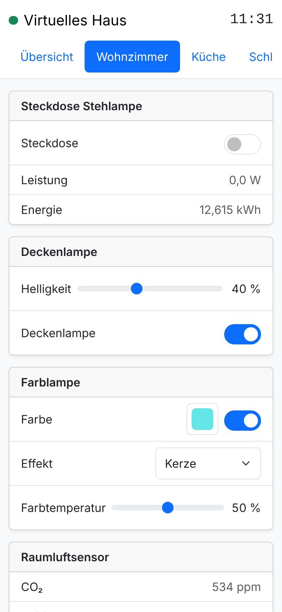
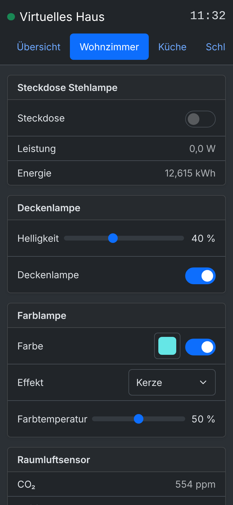
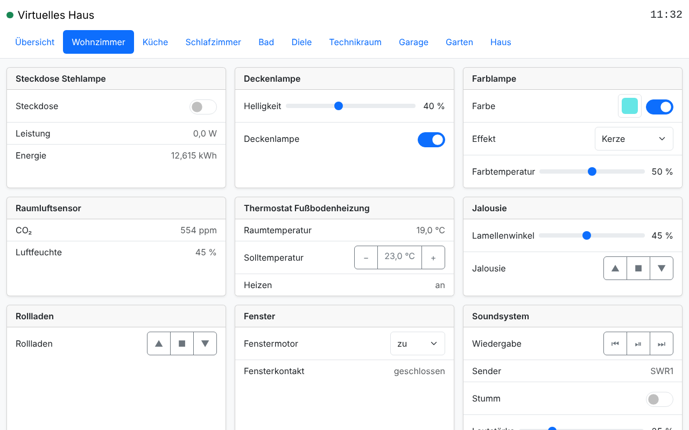

# smart-home-dashboard-theme-bootstrap

**Ansicht „bootstrap“** für das [Smart-Home-Dashboard](https://github.com/Michdo93/Smart-Home-Dashboard) (openHAB 5): das Smart-Home-Dashboard mit Bootstrap 5.

**Online-Demo:** <https://michdo93.github.io/smart-home-dashboard-theme-bootstrap-live-demo/> ([Repo](https://github.com/Michdo93/smart-home-dashboard-theme-bootstrap-live-demo))

| Smartphone hell | Smartphone dunkel |
|---|---|
|  |  |



## Idee

Viele Teams und Kunden arbeiten mit [Bootstrap](https://getbootstrap.com). Diese Ansicht baut das komplette Dashboard – Übersicht, Räume, Gerätekarten, Echtzeit – mit Bootstrap-Komponenten: Navbar, Nav-Pills, Cards, List-Groups, Form-Switch, Form-Range und Button-Groups. Hell und dunkel folgen dem System (`data-bs-theme`).

## Mehrwert

- **Vertraute Optik und Klassen** für alle, die Bootstrap kennen – leicht an ein vorhandenes Corporate Design anzupassen.
- **Kein doppelter Code:** Verbindung, Store, Echtzeit, Formate und Texte kommen aus dem Dashboard (`../js/controller.js` u. a.). Nur die Ansicht ist neu.
- **Fingerfreundlich nachgebessert:** Bootstraps Schalter und Regler sind für Mausbedienung gemacht; ein paar Regeln bringen alle Bedienflächen auf 44 px.

## Installation

Voraussetzung: das [Smart-Home-Dashboard](https://github.com/Michdo93/Smart-Home-Dashboard) ist installiert (Standard: `/etc/openhab/html/dashboard`) – ab der Fassung mit `js/controller.js`.

```bash
git clone https://github.com/Michdo93/smart-home-dashboard-theme-bootstrap
cd smart-home-dashboard-theme-bootstrap
sudo ./install.sh                       # kopiert den Ordner bootstrap/ ins Dashboard
sudo ./install.sh /pfad/zum/dashboard   # anderer Ordner
```

Aufruf: `http://<openhab>:8080/static/dashboard/bootstrap/` – mit `?room=gVH_Kueche` startet es in einem Raum, mit `?lang=en` auf Englisch. Entfernen: `sudo ./uninstall.sh`.

Die Ansicht liest Adresse, Token, oberste Gruppe und Übersicht aus der `config.js` des Dashboards und nutzt dessen `lib/openhab.min.js`.

## Unterschiede zur Standard-Ansicht

Farben wählt der Farbwähler des Browsers (`<input type="color">`, umgerechnet nach HSB). Gerätemodule, Verlaufsdiagramme und der Sperrbildschirm sind der Standard-Ansicht vorbehalten.

Enthält [Bootstrap](https://github.com/twbs/bootstrap) 5.3.8, nur CSS (MIT, `bootstrap/LICENSE.bootstrap`).

## Dateien

| Datei | Inhalt |
|---|---|
| `bootstrap/index.html` | Seite der Ansicht |
| `bootstrap/ansicht.js` | die Ansicht (View); importiert `../js/controller.js`, `../js/widgets.js`, `../js/format.js`, `../js/i18n.js` |
| `bootstrap/` (übrige) | Framework-Dateien mit Lizenzen |
| `install.sh`, `uninstall.sh` | installieren und entfernen |
| `vorschau/` | Bildschirmfotos |

## Zum Buch

Wie dieses Ansicht entsteht – Idee, Gestaltung und Code Schritt für Schritt –, beschreibt das Buch *Smart-Home-Dashboards für Webentwickler und Designer*. Wie die Online-Demo auf GitHub Pages entsteht, beschreibt *openHAB Online Demos*.

## Unterstützen

Wenn Ihnen dieses Projekt hilft, freue ich mich über einen Kaffee:

[](https://buymeacoffee.com/Michdo93)

## Lizenz

MIT – siehe [LICENSE](LICENSE). Enthaltene Bibliotheken behalten ihre eigenen Lizenzen.
